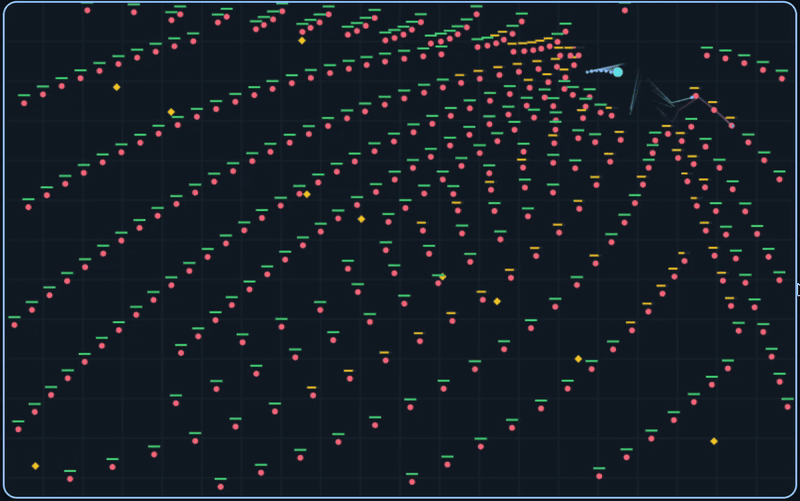

# ECS swarm example



A playable browser ECS example with the ordinary declaration-driven generalized
Root. WASD or arrows move, Space pauses, and R restarts. A keyboard is required.

The original game contains a player, 512 initial enemies and ten pickups.
Bolts target the nearest enemy. Area pulses damage nearby enemies. Chain
projectiles retain visited targets and a count-dependent bounce allowance.
Enemies move toward the player, pickups relocate on collection, and reinforcements
arrive every other frame. Existing enemy speeds remain fixed after spawning.

From the repository root:

```sh
bash examples/arena/build.sh
python3 -m http.server 8000 --directory examples/arena
```

Open `http://localhost:8000`. Generated `dist/` files are ignored. No npm packages
or external assets are required.

[gameplay.bend](gameplay.bend) preserves the original Body component and combat
calculations. Each Body carries position, kind, seed, health, speed, target,
visited targets and age. [schema.bend](schema.bend) gives the Body column its own
nominal schema and canonical affine storage owner.

Two real registered systems execute each update. The [spawn author](spawn.bend)
reserves actual handles and queues the setup, reinforcement and projectile
payloads through its declared command capability. The [gameplay system](system.bend)
declares a required Body write query and an entity-command capability. It updates
the selected actual Body owners and queues despawns using their full handles.
The query body keeps its storage scope and command queue abstract.

[root.bend](root.bend) orders spawn completion before gameplay and applies its
commands at that dependency. Final deferred application publishes the gameplay
system's despawns. Both command queues use the core's compiled publication path.
The actual registered compilations, captures, buffers and storage remain inside
the returned application across frames. [owners.bend](owners.bend) updates the
real captured input and reads the real completed row results while retaining
all node, compilation, preparation and admission owners.

The initial frame comes from a [passive inspector](observe.bend) after setup
publication. Subsequent frames contain the actual query results after each
successful write, excluding rows whose despawn was queued for the final boundary.
The nearest-target search and impact reduction deliberately use the preceding
frame's Data snapshot, preserving the original gameplay algorithm.

[game.bend](game.bend) owns the frame state and supplies those inputs to the
retained application. [browser.mjs](browser.mjs) supplies input, the fixed-step
clock and rendering. It consumes compiled `start(Unit)` and `advance(State,dx,dy)`
IO through [run-io.mjs](run-io.mjs). That small product bridge follows the
compiler-emitted synchronous continuation/foreign-effect protocol and invokes
the canonical execution driver. It does not schedule arbitrary asynchronous IO.

The migrated emitted application was run for setup and 180 movement frames.
Setup observed all 523 real bodies. At tick 180 it reported 77 kills, 525 enemies,
14 projectile/effect rows and 550 total bodies, with all six original Body kinds
present. The complete initial and final JSON were retained for the delivery.
This run preceded the final admission/report-handling repair. The final migrated
source was rebuilt and executed for setup and one frame. These are finite product
observations, not formal proofs or backend qualification. Real-browser interaction
was not rerun.

`bash examples/arena/check.sh` builds the current browser module. It does not run
gameplay, controlled scenarios, or the browser adapter.

The pre-existing controlled Bend scenarios in [fixtures.bend](fixtures.bend)
now construct this same retained application and return compiled IO. Existing
JavaScript verifier files remain untouched and retain their former synchronous
API expectations. Their historical source binding and current runner coverage
are documented in [CHECKS.md](CHECKS.md).
